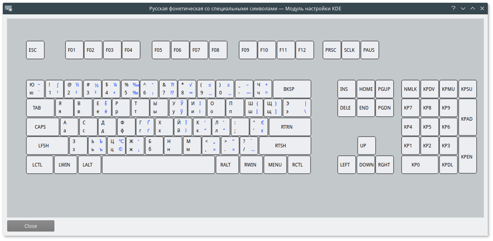

# Extended Cyrillic Phonetic Keyboard Layout

An extended Russian phonetic (ЯВЕРТЫ-style) keyboard layout, `cyrex`. The
third and fourth levels add Ukrainian and Belarusian letters (ї, і, є, ґ, ў),
ђ and џ, pre-reform Russian letters (ѣ, ѳ, ѵ, і), and common math and
typographic symbols.



## How it is installed

The layout is shipped as an [xkeyboard-config extension][ext]: a
self-contained directory that libxkbcommon picks up automatically. No system
file of `xkeyboard-config` is modified, so the layout survives its updates and
can be removed cleanly.

```
/usr/share/xkeyboard-config.d/cyrex/
├── rules/evdev.xml   # makes the layout discoverable in GNOME/KDE/etc.
└── symbols/cyrex     # the layout itself
```

### Requirements

- libxkbcommon **1.13** or newer
- xkeyboard-config **2.45** or newer
- A Wayland session (GNOME, KDE Plasma, sway, Hyprland, …). The Xorg server
  only reads its built-in XKB directory, so X11 sessions are not supported.

Check your version with `pkg-config --modversion xkbcommon`. If it is older,
use the [per-user installation](#per-user-installation-any-distribution).

## Installation

### Arch Linux

```sh
cd packaging/arch
makepkg -si
```

This builds `xkb-cyrillic-phonetic-extended-git` from the latest commit on
GitHub.

### Other distributions (system-wide)

The `Makefile` installs into the extensions directory reported by
`pkg-config --variable=xkb_unversioned_extensions_path xkbcommon`
(default `/usr/share/xkeyboard-config.d`):

```sh
make check                 # needs xmllint and xkbcli
sudo make install          # PREFIX=/usr by default
sudo make uninstall
```

For distribution packages, stage into a build root:

```sh
make DESTDIR="$pkgdir" PREFIX=/usr install
```

Notes for packagers:

- **Debian/Ubuntu** (`debian/rules`): `dh_auto_install` calls
  `make install DESTDIR=debian/<pkg>` by default. Add
  `Depends: libxkbcommon0 (>= 1.13), xkb-data (>= 2.45)`.
- **Fedora/RPM** (`.spec`): in `%install` run `%make_install`. Add
  `Requires: libxkbcommon >= 1.13, xkeyboard-config >= 2.45` and list
  `%{_datadir}/xkeyboard-config.d/cyrex/` in `%files`.
- **NixOS**: libxkbcommon from Nixpkgs does not look into
  `/usr/share`. Use the
  [`services.xserver.xkb.extraLayouts`][nixos] option instead, pointing
  `symbolsFile` at `symbols/cyrex` with `languages = [ "rus" "ukr" "bel" ]`.

The directory is architecture-independent, so `noarch`/`any`/`all` packages
are fine.

### Per-user installation (any distribution)

libxkbcommon 1.0+ also reads `$XDG_CONFIG_HOME/xkb` (`~/.config/xkb`):

```sh
make install-user
make uninstall-user
```

This overwrites `~/.config/xkb/rules/evdev.xml`. If you already have custom
layouts there, merge the `<layout>` entry from `rules/evdev.xml` by hand.

## Enabling the layout

Log out and back in after installing, then add **Cyrillic Phonetic
(Extended)** as an input source:

- **GNOME**: Settings → Keyboard → Input Sources → Add (search “Cyrillic”).
- **KDE Plasma**: System Settings → Keyboard → Layouts → Add.
- **sway**: `input type:keyboard xkb_layout us,cyrex`
- **Hyprland**: `input { kb_layout = us,cyrex }`

The third and fourth levels are reached with the system's level-3 key
(usually right Alt, configured as *Key to choose the 3rd level*).

## Upgrading from the old `install/install` script

Older versions copied `symbols/cyrex` into `/usr/share/X11/xkb/symbols/` and
patched `xkeyboard-config`'s rules files. The rules patches are already gone
after any `xkeyboard-config` update, but the stray file is left behind. Remove it:

```sh
sudo rm /usr/share/X11/xkb/symbols/cyrex
```

## TODO

- Add new symbols

[ext]: https://xkbcommon.org/doc/current/packaging-keyboard-layouts.html
[nixos]: https://search.nixos.org/options?query=services.xserver.xkb.extraLayouts
